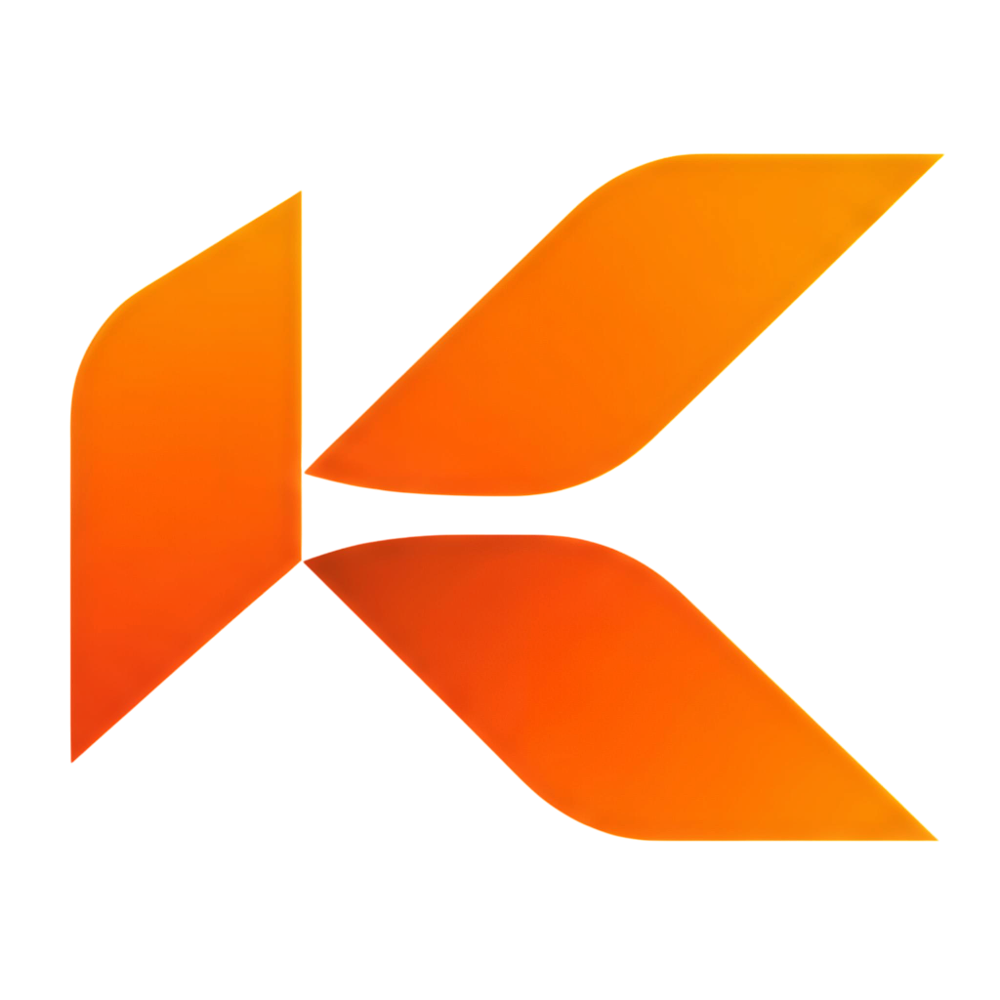
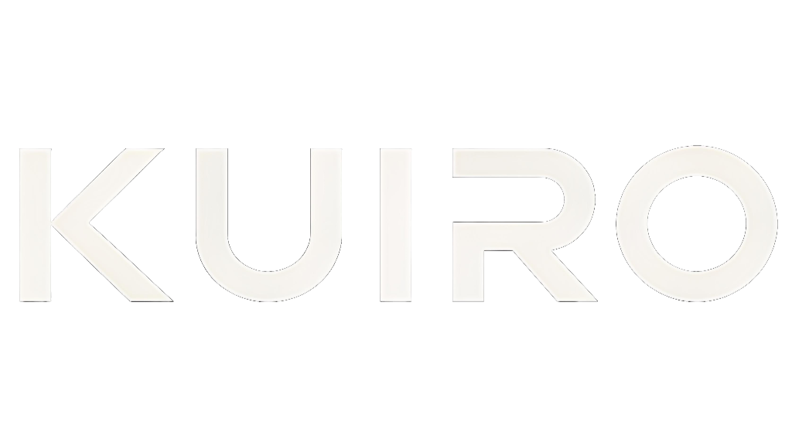
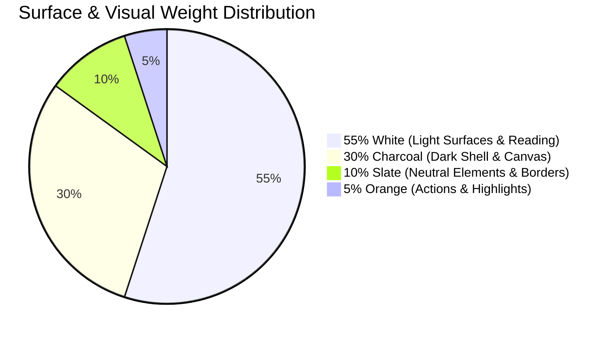
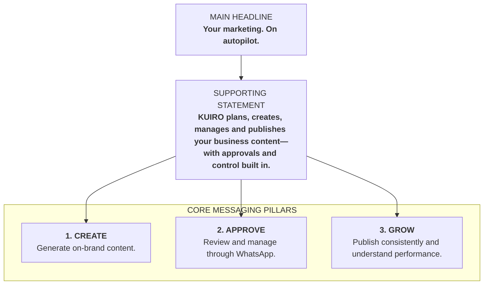

# KUIRO — Brand Identity & Design System Specification

<div align="center">
  
  <br />
  
</div>

> **"Your Always-On AI Marketing Employee."**  
> *Tagline:* **Create / Approve / Grow.**  
> *Main Headline:* **Your marketing. On autopilot.**  
> *Supporting Statement:* **KUIRO plans, creates, manages and publishes your business content—with approvals and control built in.**  
> *Industry:* AI SaaS / Autonomous Marketing Automation  
> *Promise:* Make business marketing simpler and relentlessly consistent.

---

## 1. Brand Foundation Element Direction

| Attribute | Specification |
| :--- | :--- |
| **Brand Name** | **KUIRO** |
| **Primary Tagline** | **Create / Approve / Grow.** |
| **Main Headline** | **Your marketing. On autopilot.** |
| **Supporting Statement** | **KUIRO plans, creates, manages and publishes your business content—with approvals and control built in.** |
| **Industry** | AI SaaS / Marketing Automation |
| **Personality** | **Intelligent, confident, modern, dependable** |
| **Audience** | **Indian SMBs, founders, agencies** |
| **Positioning** | **Your always-on AI marketing employee** |
| **Promise** | **Make business marketing simpler and more consistent** |

---

## 2. Logo System & Master Assets

The KUIRO logo architecture consists of three standard lockups built from the official master geometric symbol and modern typographic wordmark.

```
                    ┌──────────────────────────────────────────────┐
                    │                 KUIRO LOGO                   │
                    │               ┌──────────────┐               │
                    │      [W]      │  [SYMBOL: K] │      [W]      │
                    │  CLEAR SPACE  └──────────────┘  CLEAR SPACE  │
                    │                 K  U  I  R  O                │
                    │                                              │
                    │   Rule: Clear space on all sides >= [W]     │
                    └──────────────────────────────────────────────┘
```

### Official Master Assets
* **Geometric Symbol (Transparent PNG):** `public/brand/kuiro-symbol.png`
* **Wordmark (White on Transparent PNG):** `public/brand/kuiro-wordmark.png`
* **Vector Lockups:**
  * Primary Horizontal: `public/brand/kuiro-primary.svg` & `public/brand/kuiro-primary-light.svg`
  * Secondary Stacked: `public/brand/kuiro-stacked.svg` & `public/brand/kuiro-stacked-light.svg`
  * Standalone Icon: `public/brand/kuiro-icon.svg`

### 1. Primary Logo (Horizontal Lockup)
* **Composition:** Geometric flat "K" symbol positioned to the left of the uppercase **KUIRO** wordmark.
* **Usage:** Default lockup for website headers, navigation bars, email signatures, presentation titles, and formal partnerships.

### 2. Secondary Logo (Stacked Lockup)
* **Composition:** Geometric flat "K" symbol centered prominently above the uppercase **KUIRO** wordmark (optionally with the tagline *"CREATE / APPROVE / GROW"* underneath).
* **Usage:** Centered application launch screens, mobile modals, social media profile covers, billings, and square/vertical collateral.

### 3. Icon (Standalone Geometric K)
* **Composition:** The pure geometric flat "K" monogram in Orange (`#FF7A00`) without typographic wordmark.
* **Usage:** Browser favicons, mobile app icons, WhatsApp chat avatars, circular badges, and verified publisher marks.

### Mandatory Logo Rules & Integrity Guardrails
* **Keep the symbol flat:** Never apply drop shadows, 3D extrusions, bevels, inner glows, or decorative textures. The symbol must remain pure, flat, vector-sharp.
* **Zero Distortion:** Never stretch, compress, skew, shear, or rotate the logo symbol or wordmark under any circumstance.
* **Clear Space Requirement:** Always preserve a clear exclusion zone around the logo equal to the **full width of the "K" symbol** on all four sides. No text, icons, borders, or graphics may encroach into this buffer.
* **Color Integrity:** The symbol must always be rendered in **KUIRO Orange (`#FF7A00`)**. On dark backgrounds, the wordmark is **White (`#FFFFFF`)**; on light backgrounds, the wordmark is **Charcoal (`#0B0F14`)**.

---

## 3. Color Palette & Surface Distribution (55 / 30 / 10 / 5 Rule)



### Color Token Specification

| Color Name | Hex Code | Role & Strategic Intent |
| :--- | :--- | :--- |
| **White** | `#FFFFFF` | **55% Usage — Primary Light Surfaces:** Main content canvas, cards, reading backgrounds, light-mode foundation. |
| **Charcoal** | `#0B0F14` | **30% Usage — Dark Surfaces & Shell:** App navigation, sidebar, hero banners, dark mode background, primary typography on light mode. |
| **Slate** | `#374151` | **10% Usage — Neutral Elements:** Secondary cards, dividers, subtle button states, inactive tab containers. |
| **Orange** | `#FF7A00` | **5% Usage — Highlights & Actions:** Reserved exclusively for high-intent CTAs (*Approve*, *Publish*, *Start Trial*), selected states, and urgent alerts. |
| **Gray** | `#D1D5DB` | **Functional Token:** Subtle card borders, secondary text, metadata, timestamp trackers, inactive input outlines. |

### The 5% Orange Rule
> [!IMPORTANT]
> **Orange (`#FF7A00`) must never be used for large background areas or decorative flooding.**  
> It is an intentional, scarce high-energy beacon reserved for primary action buttons, active selection pills, and key status highlights.

---

## 4. Typography Hierarchy

KUIRO uses a dual-typeface system pairing **Sora** (an authoritative geometric sans with open counters) with **Inter** (the gold standard for digital UI precision and legibility).

| Usage Context | Typeface | Weight | CSS / Tailwind Class | Notes |
| :--- | :--- | :--- | :--- | :--- |
| **Main Headlines** | **Sora** | **Bold (700)** | `font-sora font-bold` | Tight letter spacing (`-0.02em`), confident, decisive. |
| **Subheadings & Section Titles** | **Sora** | **SemiBold (600)** | `font-sora font-semibold` | Structured hierarchy, clear grouping. |
| **Buttons & Primary CTAs** | **Sora** | **SemiBold (600)** | `font-sora font-semibold` | Pairs directly with `#FF7A00` action styling. |
| **Body Copy & Long-form** | **Inter** | **Regular (400)** | `font-inter font-normal` | Clean, effortless reading across desktop & mobile. |
| **Dashboard Metrics & Numbers** | **Inter** | **Medium (500)** | `font-inter font-medium` | Numeric clarity for timers, statistics, and ROI counts. |
| **Labels & Metadata** | **Inter** | **Medium (500)** | `font-inter font-medium` | Small uppercase tags (`text-[10px] tracking-wider`). |

---

## 5. Brand Voice & Language Framework

KUIRO’s voice is that of an exceptionally skilled, proactive senior marketing partner. We respect the business owner’s time and talk in straightforward commercial terms, not Silicon Valley hype.

### Core Voice Attributes
* **Clear, not complicated:** Say what the feature does in plain business language. Avoid nested abstractions and obscure jargon.
* **Confident, not arrogant:** Speak with authority and conviction, but never condescend to the user or assume their business priorities.
* **Helpful, not robotic:** Communicate like a trusted human colleague who is ready to take tasks off the founder's plate.
* **Intelligent, not overly technical:** Showcase deep domain expertise and cultural context without inundating the user with AI plumbing details.
* **Action-oriented, not sales-heavy:** Focus on immediate next steps, resolutions, and output. Deliver real utility rather than pushing high-pressure upsell pitches.

### Preferred Language: Say This, Not That

| Instead of (Jargon / Over-Complicated) | Say This (KUIRO Standard) | Why |
| :--- | :--- | :--- |
| *AI-powered automation ecosystem* | **AI marketing co-pilot** | Grounded in partnership; clear role definition. |
| *Content orchestration* | **Plan and publish content** | Concrete action that every business owner understands. |
| *Omnichannel intelligence* | **Manage all your channels** | Focuses on user capability rather than abstract tech. |
| *Complex workflow automation* | **Let KUIRO handle the routine** | Highlights the core benefit: freeing up the founder's time. |

---

## 6. Product Design Language & UI Rules

```
   ┌────────────────────────────────────────────────────────┐
   │                  PRODUCT DESIGN RULES                  │
   │  1. Rounded cards, 10–14px corner radius.              │
   │  2. Subtle borders instead of heavy shadows.           │
   │  3. Orange primary buttons (#FF7A00).                  │
   │  4. Charcoal sidebar (#0B0F14) and clean light         │
   │     dashboard (#FFFFFF).                               │
   │  5. Consistent geometric icons (Lucide / Feather).     │
   │  6. Minimal animations (150ms) & generous whitespace.  │
   └────────────────────────────────────────────────────────┘
```

1. **Rounded Cards (10–14px Radius):** Every card, panel, and modal container must adhere strictly to a **10px to 14px corner radius** (`rounded-[10px]` to `rounded-[14px]`).
2. **Subtle Borders Instead of Heavy Shadows:** Eliminate diffuse, muddy, heavy drop-shadows. Depth is articulated through crisp 1px borders using `rgba(209, 213, 219, 0.14)` on dark surfaces, or `#E5E7EB` on light surfaces.
3. **Orange Primary Buttons:** Primary interactive triggers (*"Approve"*, *"Publish"*, *"Extract Brand Brain"*, *"Save Settings"*) use solid **KUIRO Orange (`#FF7A00`)** with white text and `font-sora font-semibold`.
4. **Charcoal Sidebar + Clean Light Dashboard:** The application layout pairs a dark **Charcoal (`#0B0F14`)** navigation rail on the left with a clean, high-clarity **White (`#FFFFFF`)** dashboard reading canvas on the right.
5. **Consistent Geometric Icons:** Use a unified stroke weight (1.5px to 2.0px) for all iconographic cues (`lucide-react`).
6. **Minimal Animations & Generous Whitespace:** Transitions are brisk and utility-focused (150ms duration) with generous padding.

---

## 7. Brand Messaging Hierarchy



### Main Headline
> **Your marketing. On autopilot.**

### Supporting Statement
> **KUIRO plans, creates, manages and publishes your business content—with approvals and control built in.**

### Core Messaging Pillars
1. **Create — Generate on-brand content.**  
2. **Approve — Review and manage through WhatsApp.**  
3. **Grow — Publish consistently and understand performance.**  

---

## 8. The Brand Guardian 6-Point Checklist

1. **Logo Check:** Is the "K" symbol completely flat, free of gradients/shadows, unskewed, and surrounded by clear space equal to its width?
2. **Color Balance Check:** Does the view respect the 55% white / 30% charcoal / 10% slate / 5% orange allocation rule?
3. **UI Rules Check:** Do cards use 10–14px radius with subtle 1px borders and no heavy drop-shadows? Are primary buttons Orange (`#FF7A00`)?
4. **Layout Check:** Is navigation anchored in Charcoal (`#0B0F14`) and dashboard content rendered on clean light/white surfaces with generous whitespace?
5. **Typography Check:** Are all headlines and buttons using Sora (Bold/SemiBold), and all body/data elements using Inter (Regular/Medium)?
6. **Voice & Messaging Check:** Does the copy use the official headline (*"Your marketing. On autopilot."*), supporting statement, and preferred terms (*"AI marketing co-pilot"*, *"plan and publish content"*)?
